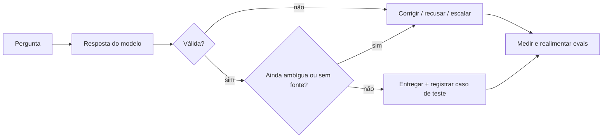

# Alucinação e comportamentos

> **Meta:** explicar por que a IA **inventa informação com aparência de verdade** e como
> essa falha vem acompanhada de inconsistência, ambiguidade e perda de contexto — e o
> que fazer para detectar e conter cada uma.

## Resumo em 3 frases

1. **Alucinação** é a IA **inventar informação** e entregá-la com aparência de resposta
   correta: o formato e o tom não distinguem verdade de invenção.
2. A seção agrupa o problema com outros três comportamentos — **inconsistência**,
   **ambiguidade** (geralmente causada por prompt ruim) e **perda de contexto** — falhas
   que aparecem juntas e derrubam a confiabilidade da saída.
3. Como a origem é a **natureza probabilística** do modelo, a resposta não é "pedir para
   não errar": é **validar a saída**, revisar planos propostos, usar **documentação real**
   como referência, bloquear comportamentos indesejados e **medir a qualidade com testes**.

## Os quatro comportamentos que a seção separa

| Comportamento | Definição (segundo os bullets) | Como reconhecer |
| --- | --- | --- |
| **Alucinação** | A IA inventa informação; a resposta *parece* correta, mas é imprecisa | O dado existe no mundo? A fonte citada existe? |
| **Inconsistência** | A mesma entrada passa a devolver algo diferente do que devolvia antes, ou a saída se contradiz | Repetir a mesma consulta muda o resultado? O texto bate com ele mesmo? |
| **Ambiguidade** | A pergunta ou a resposta admite mais de uma leitura — **geralmente causado por prompt ruim** | Dá para responder de mais de um jeito e todos "cabem" no pedido? |
| **Perda de contexto** | A informação estava no contexto, mas deixa de ser usada — por limite de janela ou por estar no meio de um contexto longo | Uma regra/dado dito antes desaparece da resposta? |

> Os sinais da coluna "como reconhecer" são **meus**, para transformar o bullet em
> pergunta de verificação. A definição de **inconsistência** também é minha interpretação:
> "busco algo que antes retornava de um jeito e agora retorna diferente". A seção define os
> quatro comportamentos; não detalha (nos meus bullets) como medi-los. Fichas:
> [[Alucinação]] · [[Inconsistência]] · [[Ambiguidade]] · [[Perda de Contexto]].

## O que a seção aborda (escopo declarado)

- Os **principais tipos de falha** que uma IA pode cometer.
- **Alucinação** como foco: como a IA gera respostas que **parecem corretas**, mas são
  **inventadas e imprecisas**.
- **Incoerência**, **ambiguidade** e **limites do contexto**, e como impactam a
  confiabilidade das saídas.
- **Por que** essas falhas ocorrem e como se relacionam com a **natureza probabilística**
  dos modelos.
- **Mecanismos de controle** para mitigar os riscos em aplicações práticas.
- **Validar saídas**, **revisar planos propostos**, usar **documentações reais** como
  referência, **bloquear comportamentos indesejados** e **medir a qualidade com testes**.

## Objetivos

- [ ] Identificar as falhas mais comuns em IAs
- [ ] Compreender o conceito de alucinação em modelos de IA
- [ ] Reconhecer a influência de ambiguidade e inconsistência
- [ ] Aprender sobre limites de contexto em IA
- [ ] Aplicar mecanismos de controle para mitigar erros
- [ ] Desenvolver estratégias de validação de saída

## Por que acontece: a base probabilística

> Ligação com o que já estudamos — **não** é um detalhe novo da[[Alucinação e comportamentos]].

O modelo estima a **continuação mais provável** do texto, não "a resposta verdadeira"
(ver [[Modelos de Linguagem: como funcionam]] e [[Alucinação]]). Por isso uma resposta falsa
pode ser tão fluente quanto uma verdadeira: o objetivo de treino premia
**plausibilidade**, não veracidade. [[Temperatura]] e amostragem mudam o quanto a saída
se arrisca fora do topo da distribuição (ver [[Temperatura e previsibilidade]]).

A consequência prática é a que a seção cobra: **não existe autoavaliação confiável**.
Quem diz se a saída está certa é uma verificação **externa** — fonte, documento real,
validação em código, revisão humana ou teste.

## Mecanismos de controle citados na seção

| Controle | O que a seção propõe | Como eu pretendo verificar |
| --- | --- | --- |
| **Validar saídas** | conferir a resposta antes de entregá-la ao usuário | schema/regra de domínio + conferência com a fonte (ver [[Grounding]]) |
| **Revisar planos propostos** | revisar **com o agente** o plano que ele propôs, antes de executar: o que ele entendeu, os passos, os dados que vai usar e o resultado esperado | o plano está coeso? cada passo corresponde ao pedido? o que pode sair diferente? |
| **Documentação real como referência** | usar doc oficial/real em vez da memória do modelo | citar a fonte de cada afirmação técnica; recusar quando não houver fonte |
| **Bloquear comportamentos indesejados** | impedir entradas/saídas fora da política | guardrails de entrada e saída, testados contra falso positivo (ver [[Guardrails]]) |
| **Medir a qualidade com testes** | medir o sistema, não confiar na impressão | conjunto de casos versionado, rodando a cada mudança (ver [[Evals]]) |

> **O que é "revisar planos propostos" (fechado):** é a revisão do **plano do agente com
> o agente**, antes da execução — conferir se o que ele planejou está **coeso** e se
> **corresponde** ao pedido. Não é revisar a resposta final; é pegar o desvio antes de ele
> virar ação. Critério prático: reler o plano elo por elo — entendeu o pedido? escolheu os
> dados certos? a sequência fecha? o resultado esperado é o que eu pedi?

## Síntese em um fluxo

## Exemplo concreto (ilustrativo, meu)

> Não é o exemplo. É um caso que eu consigo reproduzir para reconhecer cada falha
> no mesmo cenário.

**Pedido:** "escreva um script em Python que leia `vendas.csv`, calcule a média de vendas
por mês e gere um resumo executivo".

| Falha | O que apareceria | Por que é essa falha |
| --- | --- | --- |
| **Alucinação** | `df.sample_frac(0.1)` para tirar uma amostra | `sample_frac` existe no dplyr (R), não no pandas: o método **parece** plausível e só quebra quando roda (`AttributeError`). |
| **Inconsistência** | na segunda-feira o resumo diz "média mensal: R$ 42.300"; na terça, mesmo CSV, "R$ 38.900" | o critério mudou (média das vendas × média dos dias) sem aviso. Não é fato inventado: é resultado que não se repete. |
| **Ambiguidade** | o script calcula total do mês, mas eu queria média por venda | "média de vendas por mês" admite as duas leituras; o problema está no pedido, não no cálculo. |
| **Perda de contexto** | eu disse "valores em centavos" no início; 30 mensagens depois ele divide por 100 de novo | a regra estava no contexto, mas saiu do alcance efetivo (janela ou meio do contexto). |

**Como o exemplo vira controle:** rodar o script pega a alucinação de API; rodar duas
vezes e comparar pega a inconsistência; pedir o critério antes de calcular fecha a
ambiguidade; reancorar a regra dos centavos no ponto de uso segura a perda de contexto.

## Erros comuns / armadilhas

- ❌ Tratar **fluência como evidência de verdade** — o tom confiante é estilo, não
  calibração (ver [[Moderação de conteúdo com IA]]).
- ❌ Achar que **prompt melhor elimina alucinação**. Prompt melhor reduz ambiguidade;
  não cria fonte de verdade.
- ❌ Confundir **"respondeu o que eu quis"** com **"respondeu corretamente"**.
- ❌ Testar só o caso feliz e concluir que o sistema está pronto (ver [[Evals]]).
- ✅ Para cada afirmação factual, perguntar: **qual é a fonte?** Sem fonte, não entra na
  saída (ver [[Grounding]]).

## O que ficou fechado e o que ainda está aberto

- ✅ **Inconsistência** é falha separada da alucinação: a resposta pode estar correta e
  ainda assim mudar entre execuções. Ver [[Inconsistência]].
- ✅ **Perda de contexto** acontece pelos dois mecanismos: limite de [[Janela de Contexto]]
  e evidência no meio do contexto ([[Lost in the Middle]]). Ver [[Perda de Contexto]].
- ✅ **"Revisar planos propostos"** é revisar com o agente o plano dele antes de executar,
  checando coesão e correspondência com o pedido.
- ✅ **Ambiguidade** tem causa principal no prompt, mas também pode vir do domínio ou da
  própria resposta. Ver [[Ambiguidade]].
- [ ] **Como medir alucinação** de forma reproduzível — taxa por tipo de pergunta, com
  [[Evals]] ou revisão humana amostrada? Fica para a ficha [[Evals]].

## Referências

- Fichas: [[Alucinação]] · [[Inconsistência]] · [[Ambiguidade]] · [[Perda de Contexto]] · [[Janela de Contexto]] · [[Lost in the Middle]] · [[Temperatura]] · [[Grounding]] · [[Guardrails]] · [[Evals]] · [[Human-in-the-loop]]

- Ver também: [[Ambiguidade e riscos na IA]] · [[Engenharia de prompt e contexto]] · [[Moderação de conteúdo com IA]]

