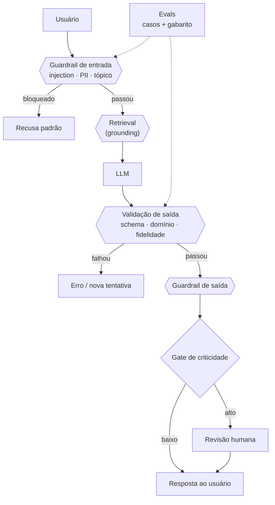

# Moderação de conteúdo com IA

> **Meta:** entender **por que a IA erra** e quais **controles de moderação** reduzem o
> dano de uma resposta errada — da ancoragem no dado real até a medição contínua do
> sistema inteiro.

## Resumo em 3 frases

1. A IA **erra porque trabalha com probabilidades**: ela gera a continuação mais
   provável do texto, então uma resposta falsa pode aparecer com a mesma fluência de
   uma verdadeira — e a confiança da linguagem não é confiança do conteúdo.
2. Cinco controles cobrem o problema: **grounding** (responder com dado real),
   **validação de saída**, **guardrails**, **human-in-the-loop** e **evals** — cada um
   pega um erro que os outros não pegam.
3. Moderação não é uma camada, é uma **pilha**: o erro sempre escapa de alguma camada,
   e o que segura o sistema é o conjunto — mais o que se faz quando mesmo assim escapa.

## 1. Por que a IA erra: ela trabalha com probabilidades

- O modelo estima a **distribuição do próximo token** — não "a resposta certa"
  (ver [[Logits]] e [[Modelos de Linguagem: como funcionam]]).
- A amostragem é estocástica: [[Temperatura]], top-p e top-k decidem o quanto se
  arrisca fora do topo da distribuição (ver [[Temperatura e previsibilidade]]).
- Consequência de medição: a qualidade do modelo é uma **média**, e a média esconde a
  cauda — o erro que importa é justamente o da cauda (caso raro, alto impacto).
- Erro confiante: a resposta falsa tem a mesma estrutura e o mesmo tom de "quem sabe"
  da verdadeira.

### Por que o modelo não percebe o próprio erro

| Motivo | Consequência |
| --- | --- |
| Não tem acesso à verdade — só à probabilidade de continuação | não existe "sinal interno de dúvida" confiável |
| Verdade e mentira são igualmente plausíveis como texto (ver [[Alucinação]]) | o modelo não foi treinado para distinguir |
| Confiança da linguagem é **estilo**, não probabilidade calibrada | "tom confiante" ≠ "verdadeiro" |

> **Consequência de projeto:** não se pede ao modelo que se autoavalie. A verificação
> tem que vir de fora — schema, fonte, classificador ou humano.

## 2. As cinco camadas de moderação

| Camada | O que faz | Pega qual erro | Onde vive | Custo |
| --- | --- | --- | --- | --- |
| **Grounding** | ancora a resposta em dado real recuperável | alucinação factual | pipeline de retrieval | tokens + latência de busca |
| **Validação de saída** | schema, tipos, regras, conferência com a fonte | saída quebrada, número fora do range, citação inventada | **código** | baixo, determinístico |
| **Guardrails** | política de entrada e saída | conteúdo proibido, PII, [[Prompt Injection]], tópico fora de escopo | **código** (preferível) ou prompt | latência + falsos positivos |
| **Human-in-the-loop** | revisão humana onde o erro é caro | o residual que nenhuma regra pega | **processo** | atrito, fila, custo alto |
| **Evals** | medir se as camadas acima seguram | regressão silenciosa | **CI** | dataset + rodagem |

> A ordem importa: **grounding antes da validação** (não dá para conferir com a fonte
> o que não veio da fonte), **validação antes do humano** (não se gasta revisor com
> saída quebrada) e **evals por último** (só mede o que já existe).

## 3. Grounding — responder com dados reais

- **Definição:** ancorar a resposta em dados verificáveis externos ao modelo, em vez da
  memória paramétrica (ver [[Grounding]] e [[RAG]]).
- O caminho: recuperar (busca híbrida) → passar no contexto com **citação** →
  instruir a **recusar** ("não consta") quando não há evidência.
- Regra de ouro: **todo claim factual vem com a fonte que o sustenta**. Sem fonte, não
  vai para a saída.
- **Grounding parcial** é o erro típico: a resposta *parece* ancorada, mas os números
  saíram do modelo. O teste rápido: **apagar o contexto muda a resposta?** Se não muda,
  não está grounded.
- O grounding também falha por posição: evidência relevante no meio do contexto é
  evidência perdida (ver [[Lost in the Middle]]).

## 4. Controle e validação de saída

Quatro níveis, do mais mecânico ao mais semântico:

| Nível | Checagem | Ferramenta |
| --- | --- | --- |
| **Estrutural** | a saída é JSON válido? tem os campos? | JSON Schema / structured output |
| **De domínio** | tipos, ranges, enums, datas coerentes, valores dentro da política | código |
| **De fidelidade** | cada afirmação existe na fonte? | extrair claims → conferir contra o trecho recuperado |
| **De negócio** | a resposta atende à regra que só o domínio conhece | regras explícitas |

- **Validação em código, não em prompt.** Prompt pede; código garante. A regra que só
  existe no texto do prompt é uma regra que pode ser ignorada — ainda mais com
  [[Prompt Injection]] no meio.
- O padrão do fluxo: **se a saída não passa no validador, ela não vira resposta** —
  vira erro, nova tentativa ou escalada para humano.
- Structured output é **garantia por construção, não pedido**: o decoder é mascarado
  para só emitir tokens válidos segundo o esquema.

## 5. Guardrails

- **De entrada**: o que não deve entrar no prompt — PII, conteúdo proibido, tentativa
  de tirar o sistema do trilho.
- **De saída**: o que não deve sair — PII, conteúdo impróprio, formato proibido,
  vazamento da instrução do sistema, confiança indevida em domínio sem base.
- Guardrail é **política executada**, não texto pedido. Por isso a maioria vive em
  código, entre o modelo e o mundo.
- O custo real do guardrail é o **falso positivo**: quem bloqueia uma pergunta legítima
  paga o preço, e o usuário deixa de confiar no sistema. Toda regra precisa de teste
  de falso positivo e de um caminho de escape (pedir revisão humana).
- Guardrail **degrada com troca de modelo**: a mesma regra pode se comportar de outro
  jeito com outro modelo ou outra versão. Trocar modelo obriga a re-testar a política.

## 6. Human-in-the-loop

- **Onde entra:** não é revisão de tudo — é o **gate de criticidade** (ver
  [[Estratégia híbrida de modelos]]): só o que tem custo alto de erro passa
  por ele.
- **Três modos:**

| Modo | Como funciona | Quando usar |
| --- | --- | --- |
| Aprovação antes | bloqueia até o humano aprovar | ação irreversível, alto valor |
| Aprovação depois | publica e o humano monitora/corrige | risco médio, custo de reversão baixo |
| Amostragem | revisa X% e usa como medição de qualidade | verificação contínua em volume |

- **O problema do humano:** vira gargalo e atrito — e quando cansa, deixa de revisar de
  fato. Revisão humana cansada não é controle.
- **O humano é caro:** ele é o último recurso, não o primeiro. Use para o residual que
  regra não pega.
- **O humano também erra:** aprova por hábito. Mitigação: checklist, revisão cega,
  medir a concordância com o gabarito e monitorar a taxa de aprovação (100% de
  aprovação é sinal de rubber-stamping, não de qualidade).

## 7. Evals

- **Eval é o conjunto versionado de casos com gabarito**, rodado a cada mudança, para
  medir a qualidade do sistema (ver [[Evals]]).
- Serve para três perguntas: (a) a mudança melhorou ou piorou? (b) a camada de
  moderação segura o que deve? (c) o caso adversarial está coberto?
- **Tipos de caso que importam:** nominal (funciona?), adversarial (injection,
  contexto contraditório), de borda (limite do schema), de cauda (raro e caro).
- **Armadilha:** eval sem dado real do domínio é teatro — mede a compliance com o
  prompt, não a qualidade real. E eval que nunca falha não mede nada: se o gabarito
  não distingue resposta boa de ruim, o número é decorativo.
- O eval é o que fecha o ciclo: **cada incidente vira caso de teste**.

## 8. A pilha completa, em uma imagem

## 9. O exemplo que amarra tudo

Um assistente que responde sobre **contratos** (o caso jurídico que fecha a disciplina):

- **Grounding** — a resposta só cita cláusulas do contrato anexado; sem cláusula
  correspondente, a saída é "não consta no documento".
- **Validação** — a cláusula citada precisa existir no documento (match verificável) e
  o prazo extraído precisa ser uma data válida e coerente com as outras.
- **Guardrails** — nada do contrato sai do perímetro (confidencialidade); recusa
  automática quando a pergunta não é sobre o documento.
- **Humano** — o parecer que vai para o cliente passa por revisão humana; o resumo
  interno, não.
- **Evals** — 50 casos com gabarito, incluindo a cláusula ambígua, a pergunta sem
  resposta no documento e a pergunta que tenta extrair a instrução do sistema.

> Nenhuma camada sozinha segura esse caso. É a pilha que segura.

## Perguntas para validar

1. Por que "pergunte ao modelo se ele tem certeza" não funciona como moderação — o que
   precisaria existir para funcionar?
2. Em um sistema novo, qual camada entra primeiro e qual entra por último? Justifique
   pelo custo.
3. Guardrail escrito no prompt ou em código: o que muda quando o modelo é trocado?
4. Quando a revisão humana vira gargalo, o que se ajusta: o volume, o escopo do que
   chega nela ou a priorização?

## Ver também

- [[Riscos e falhas em projetos de IA]] · [[Alucinação]] · [[Prompt Injection]] · [[RAG]] · [[Lost in the Middle]] · [[Temperatura]]
- [[Guardrails]] · [[Human-in-the-loop]] · [[Evals]] · [[Grounding]] · [[Estratégia híbrida de modelos]]

