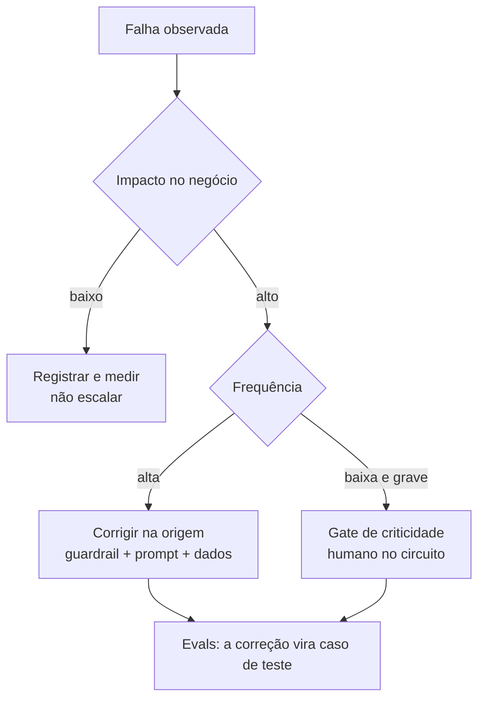

# Riscos e falhas em projetos de IA

> **Meta:** abrir a disciplina de riscos e falhas com o enquadramento que falta nas
> três anteriores: em IA, **falha não é exceção — é taxa**. A seção define o
> vocabulário de risco e mostra por que a resposta à pergunta "como evitar que a IA
> erre?" não é "testar mais", e sim **camadas empilhadas**.

## Resumo em 3 frases

1. Um sistema de IA erra **por construção**: ele estima a continuação mais provável do
   texto, não a resposta verdadeira — o erro é uma taxa esperada (ver [[Alucinação]]).
2. Por isso o risco não se resolve com teste: exige **camadas** — ancoragem no dado
   real, validação de saída, guardrails, humano nos casos críticos e medição contínua.
3. O trabalho da disciplina é transformar erro inevitável em **risco gerenciado**:
   documentado, medido, com alguém decide o que pode passar.

## O que muda quando o sistema erra por probabilidade

| | Software determinístico | Sistema de IA |
| --- | --- | --- |
| Origem da saída | regra escrita | distribuição de probabilidade |
| Erro | exceção (bug) | taxa esperada (amostragem) |
| Teste | entrada → saída fixa | entrada parecida → saída variável |
| Cobertura | conjunto de casos | distribuição, com cauda |
| Correção | conserta o código | conserta o **contexto**, o **guardrail** ou a **decisão de projeto** |

> A frase que resume a disciplina: **em software determinístico o erro é defeito; em
> IA probabilística o erro é parâmetro do sistema.** Muda o que se mede, quem assina e
> como se protege.

## A anatomia de uma falha

Quatro perguntas — as mesmas que um post-mortem precisa responder:

1. **O que** o sistema fez de errado? (resposta alucinada, dado vazado, saída fora do formato)
2. **Por quê?** (contexto faltando, recuperação errada, prompt ambíguo, [[Prompt Injection]], modelo trocado)
3. **Qual o impacto?** (gravidade × frequência — o gate de criticidade da [[Estratégia híbrida de modelos]])
4. **O que impede de repetir?** (guardrail novo, eval novo, mudança de processo)

Sem a 4, a falha vira história. Com ela, vira controle.

## O mapa do risco na disciplina

| Risco | Como se manifesta | Onde é tratado |
| --- | --- | --- |
| **Alucinação** | resposta plausível e falsa | Alucinação e Comportamentos · [[Alucinação]] |
| **Erro de arquitetura** | limitação estrutural do modelo (atenção, janela, memória) | Erros Inerentes à Arquitetura |
| **Falha em cascata** | um ponto único derruba o fluxo inteiro | Design de Sistemas Resilientes |
| **Fato sem lastro** | resposta sem fonte verificável | Grounding e Verificação de Fatos · [[Grounding]] |
| **Saída fora da política** | conteúdo impróprio, PII, prompt injection | Guardrails e Segurança na IA · [[Guardrails]] |
| **Erro humano caro** | decisão crítica sem revisão | Human-in-the-loop · [[Human-in-the-loop]] |
| **Qualidade não medida** | otimização no escuro | Evals · [[Evals]] |

## A régua de priorização: gravidade × probabilidade

Nem todo erro merece o mesmo controle. O critério que ordena as prioridades:

- **Erro frequente e de baixo impacto**: irrita, não quebra. Vira métrica, não prioridade.
- **Erro frequente e de alto impacto**: bug de verdade. Correção na origem.
- **Erro raro e grave**: o caso que assusta o jurídico e o conselho. Vai para revisão humana — porque nenhuma regra pegaria um caso que você nem imaginou.

> A nota de moderação (Moderação de Conteúdo com IA) abre exatamente esse intervalo:
> como moderar o conteúdo para que a falha vire **ruído controlado** e não **incidente**.

## A postura: gerenciar, não eliminar

- Nenhum sistema de IA é infalível. A pergunta não é "como eliminar o erro?", e sim
  **"quanto erro, de que tipo, com que impacto e quem absorve?"**
- Cada camada de defesa tem custo — tokens, latência, atrito humano, complexidade. A
  escolha é um trade-off, como em [[Trade-offs na escolha do modelo]].
- **O que não é medido não é gerenciado**: sem [[Evals]], cada defesa é achismo com
  aparência de engenharia.
- Falha é dado de treino: cada incidente vira caso de teste, guardrail ou mudança de
  política. É assim que o erro deixa de ser surpresa.

## Checklist de partida (antes de colocar em produção)

- [ ] **Mapa do risco da tarefa** — o que o modelo faz e qual é o pior erro possível
- [ ] **Gate de criticidade** — definido o que vai para humano e o que não vai
- [ ] **Fonte de verdade** — existe dado real para ancorar? (sem isso, é otimismo)
- [ ] **Validação de saída** — schema e regras de domínio implementadas em código
- [ ] **Guardrails** — de entrada e de saída, com teste de falso positivo
- [ ] **Evals** — dataset versionado com casos ruins, rodando a cada mudança
- [ ] **Observabilidade** — log de entrada, saída, versão de prompt, versão de modelo

## O mapa da disciplina

| Item | Nota | O que responde |
| --- | --- | --- |
| Abertura: riscos e falhas | [[Riscos e falhas em projetos de IA]] | Como pensar risco em IA; por que teste sozinho não basta |
| Moderação de conteúdo | [[Moderação de conteúdo com IA]] | Quais controles reduzem o dano de uma resposta errada |
| Alucinação e Comportamentos | — | Como o modelo erra e com que frequência |
| Erros Inerentes à Arquitetura | — | Quais limitações são estruturais (não se corrigem com prompt) |
| Design de Sistemas Resilientes | — | Como o sistema sobrevive à falha de uma peça |
| Grounding e Verificação de Fatos | — | Como ancorar a resposta no dado real |
| Guardrails e Segurança na IA | — | Como barrar o que não deve entrar nem sair |
| Human-in-the-loop: Revisão Humana | — | Onde o humano entra sem virar gargalo |
| Evals: Medindo a Qualidade da IA | — | Como medir se as defesas seguram |
| Entrega final — IA no Setor Jurídico | — | Aplicação da disciplina num caso de alto risco |

> Cada item da disciplina, na ordem oficial; as seções restantes ainda não têm nota.

## Perguntas para validar

1. Por que "testar e corrigir" não funciona como estratégia de segurança em IA, e o
   que substitui isso?
2. Um erro raro e de impacto alto e um erro frequente de impacto baixo: por que o
   primeiro exige humano e o segundo não?
3. Em que ponto de um projeto de IA o risco deixa de ser uma issue e vira um
   **critério de arquitetura**?
4. Se cada camada de defesa custa tokens, latência ou tempo humano, como se decide
   quais camadas existem em um sistema pequeno?

## Ver também

- [[Moderação de conteúdo com IA]] · [[Alucinação]] · [[Prompt Injection]] · [[Lost in the Middle]]
- [[Ambiguidade e riscos na IA]] · [[Quando não usar inteligência artificial]] · [[Quando nao usar IA]]
- [[Guardrails]] · [[Human-in-the-loop]] · [[Evals]] · [[Grounding]]

